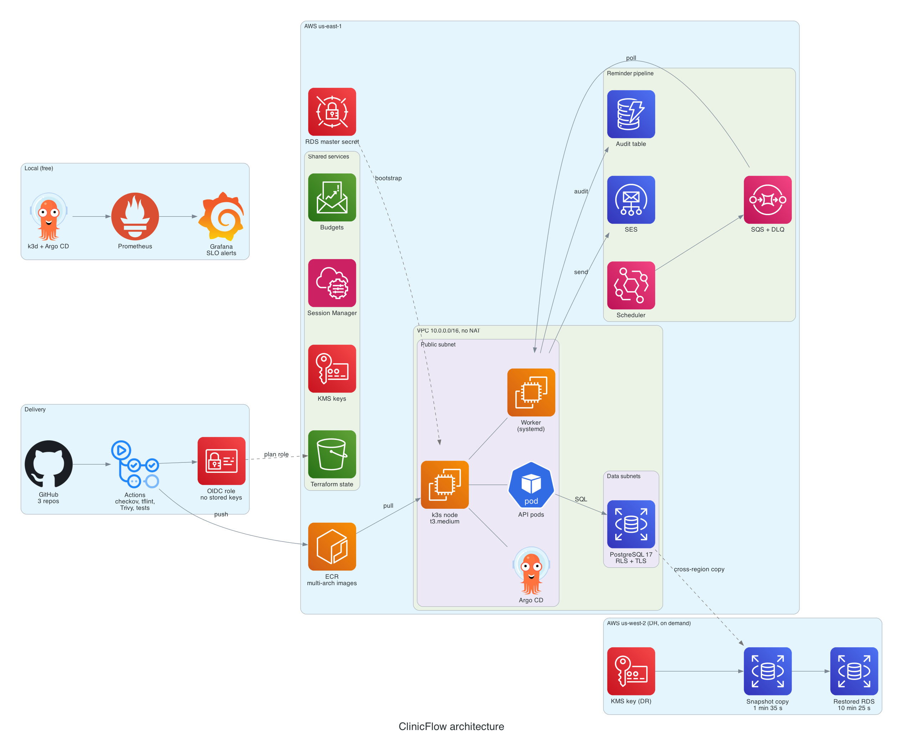

# ClinicFlow

A multi-tenant appointment and reminder platform for small clinics, built as a
cloud engineering portfolio project. The application is deliberately small. The
platform around it is the point: infrastructure as code, CI/CD, GitOps,
security, observability, cost control and disaster recovery on AWS.

To run it, see [Getting started](docs/getting-started.md).

Three repositories:

- [clinicflow-infra](https://github.com/Apoor-Tyagi/clinicflow-infra): Terraform for AWS (this repository)
- [clinicflow-app](https://github.com/Apoor-Tyagi/clinicflow-app): the API, the reminder worker and the container image
- [clinicflow-gitops](https://github.com/Apoor-Tyagi/clinicflow-gitops): what runs in the cluster, synced by Argo CD

## What it does

A clinic books appointments, and patients get an email reminder before each one.
EventBridge Scheduler puts reminders on an SQS queue, and a worker sends them
through SES. Failures retry, and after three receives a message moves to a
dead-letter queue. Each clinic sees only its own rows, enforced by PostgreSQL
row-level security.

## Design choices

- One k3s node on EC2 instead of EKS, because a managed control plane bills while
  idle. Every session ends with `terraform destroy`.
- No NAT gateway, no SSH. Access is through Session Manager.
- No stored cloud credentials. GitHub Actions assumes roles through OIDC.
- Secrets never enter Git or Terraform state. The database password is managed
  by RDS and read at boot.
- Every decision is recorded in [docs/adr](docs/adr).
- The disaster recovery steps and measured times are in the [runbook](docs/runbooks/disaster-recovery.md).
- Risks, controls and known gaps are in the [threat model](docs/threat-model.md).
- A walkthrough of the project for interviews is in [interview prep](docs/interview-prep.md).

## Evidence

All figures come from real runs. The measurement notes are in the ADRs.

| Claim | Result |
|---|---|
| Node memory | t3.small: 278 MiB available. t3.medium: 1,918 MiB available |
| Load baseline (k6, 20 users, 3 minutes, one port-forward) | 96,215 requests, about 535 per second, p95 91 ms, 0% errors |
| Tenant isolation on RDS | The application role sees no rows without a clinic set. The master user is outside the guarantee ([ADR 0010](docs/adr/0010-data-tier.md)) |
| Reminder pipeline | Delivered, duplicate dropped, bad message in the DLQ after three receives 60 seconds apart, no addresses in logs |
| Disaster recovery drill | Cross-region restore in 16 min 6 s of AWS time, RPO 43 s ([ADR 0013](docs/adr/0013-disaster-recovery-drill.md)) |
| Dead-letter queue alarm | A malformed message reached the dead-letter queue 3 min 19 s after it was sent, and the email alarm fired 6 min 4 s after it was sent ([ADR 0012](docs/adr/0012-reminder-messaging.md)) |
| Duplicate reminders | The same reminder sent twice, 60 s apart, produced one email and one audit record; the worker logged the second as a dropped duplicate ([ADR 0012](docs/adr/0012-reminder-messaging.md)) |
| Scheduled backups | A backup started by hand completed in about 4 min and its cross-region copy in about 3.5 min, into an encrypted vault in us-west-2. The daily schedule itself has not yet been observed running ([ADR 0014](docs/adr/0014-scheduled-backups.md)) |
| Instance role from a pod | A pod timed out requesting a metadata token (curl exit 28) while the node itself got HTTP 200 |
| Booking in the UI to an email | A booking made in the front desk UI was scheduled by the dispatcher at 14:12:53 UTC and sent by the worker at 14:13:58 UTC, with one audit record and no bounce. The email landed in spam ([ADR 0016](docs/adr/0016-reminder-dispatcher.md)) |
| SES sandbox recipient permission | The first real sends failed with AccessDenied because sandbox SES checks `ses:SendEmail` against the recipient identity as well as the sender. Found by repeating the send as the node role; fixed in the IAM policy ([ADR 0016](docs/adr/0016-reminder-dispatcher.md)) |
| SLO alert under fault injection (local, 5% failures) | Fast-burn alert pending 19 s after the first failure, firing after 2 min 36 s, resolved about 4 min after the failures stopped. A low-traffic baseline makes this faster than a busy service would be |
| Cost of the AWS sessions | $0.06 of billed usage so far (EC2 $0.03, RDS $0.02, ECR $0.01), with no credits applied. Billing lags by a day or two, so the latest sessions, including the DR drill, are not yet in that figure. Every session ended with a destroy |

## Pipelines

- Infrastructure: fmt, validate, tflint, checkov and a read-only `terraform plan`
  on every pull request. Apply is manual.
- Application: tests, six tenant isolation tests against a real PostgreSQL, a
  Trivy scan that fails on fixable high findings, and a multi-architecture image
  pushed to ECR from `main` only.
- Branch rulesets on all three repositories, pre-commit hooks, and Dependabot.

## What I would change for production

- Managed Kubernetes, private subnets with NAT or interface endpoints, and
  Multi-AZ RDS.
- Per-pod identity (IRSA or Pod Identity) instead of a worker on the host.
- Automated cross-region backup replication, and SES out of sandbox mode.
- Required status checks and reviews, and image-tag automation.

## Known limits

- The API covers clinics, patients and appointments, with a basic front desk UI. There is no
  login beyond a clinic API key, and appointments cannot be rescheduled or edited.
- Delivery is at-least-once, so a crash between sending and recording can send
  one email twice ([ADR 0012](docs/adr/0012-reminder-messaging.md)).
